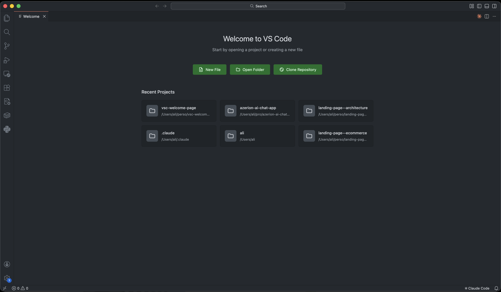

# Custom Welcome Page

A VS Code extension that replaces the default welcome page with a clean, customizable view showing your recent projects in a grid layout.

## Features

- **Recent Projects Grid** - Quickly access your recent projects with a single click
- **Search** - Filter recent projects by name or location as you type (press `/` to jump to the search box, `Enter` opens the first match, `Esc` clears). Search covers every recent project, not just the ones shown.
- **Show all** - The page shows your 10 most recent projects; a button expands the list to show everything.
- **Hover details** - Hovering a card shows the full name, full location and note, even when they're truncated.
- **Sort** - Recently opened, Name (A–Z), Name (Z–A), or Location. Your choice is remembered.
- **Pinned projects** - Star a project and it stays at the top, whatever the sort order, even if VS Code later drops it from its recent list.
- **Missing-folder cleanup** - Projects whose folder was moved or deleted are dimmed and marked "Not found", with a button to remove them from the list.
- **Keyboard control** - Arrow keys move between cards, `1`–`9` open the first nine, `Shift+1`–`9` open in a new window, `P` pins, `T` adds a note/colour, `/` searches.
- **Open in a new window** - Use the small window button, `Ctrl/Cmd+click`, middle-click, or `Shift+Enter`.
- **Notes & colour tags** - Add a short note (up to 40 characters) and a colour to tell similarly named projects apart. Notes are searchable.
- **Workspaces & remote projects** - Multi-root workspaces open as workspaces (not as a plain folder), and SSH/WSL/container projects open on their real remote address.
- **Theme Aware** - Automatically matches your VS Code theme (light/dark)
- **Quick Actions** - New File, Open Folder, and Clone Repository buttons
- **Configurable** - Adjust the number of projects displayed

## Configuration

| Setting | Description | Default |
|---------|-------------|---------|
| `customWelcome.maxProjects` | Number of most-recent projects shown before the "Show all" button (pinned projects are always shown) | 10 |

## Privacy & security

Everything stays on your machine: pins, notes and colours are saved in the extension's own storage, and the page makes no network requests. The page can only ask the extension to open or remove projects that are in your recent list (or pinned), so it cannot be used to open arbitrary paths.

## Usage

The welcome page appears automatically when you open VS Code without a folder. You can also open it manually:

1. Press `Cmd+Shift+P` (Mac) or `Ctrl+Shift+P` (Windows/Linux)
2. Type "Show Custom Welcome Page"
3. Press Enter

## Author

Ali Madjaji

## License

MIT License - see [LICENSE](LICENSE) for details.
